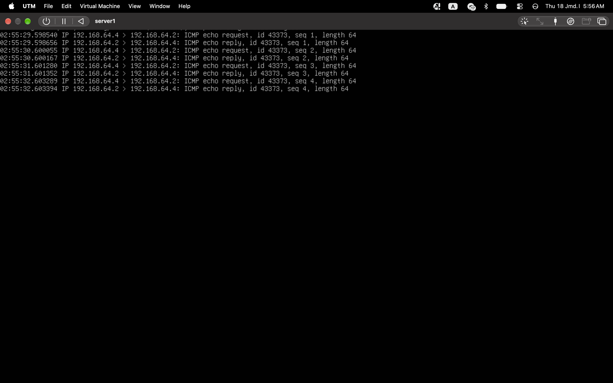
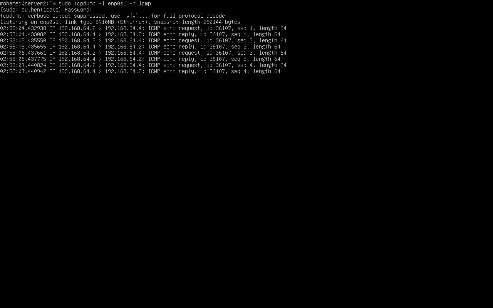

# Network Traffic Analysis Lab

## Overview
A small lab that captures and analyzes ICMP (ping) traffic between two Ubuntu Server VMs.

## Environment
- Host: MacBook Pro (M1), UTM
- VMs: server1 (192.168.64.2) and server2 (192.168.64.4)
- OS: Ubuntu Server 26.04 LTS (ARM64), Shared Network

## Steps
1. Created two VMs and verified connectivity with ping.
2. Ran tcpdump on one VM while the other sent ping requests.
3. Repeated in the opposite direction.

Command used:

    sudo tcpdump -i enp0s1 -n icmp

## Results
Each echo request was answered by an echo reply with the same sequence number, in both directions (0% packet loss).

## What I learned
- Reading packets as source > destination.
- ICMP works at Layer 3 and has no ports.
- A ping sweep (one source IP pinging many addresses) is a reconnaissance indicator.
- Verify before blocking, to avoid false positives.
